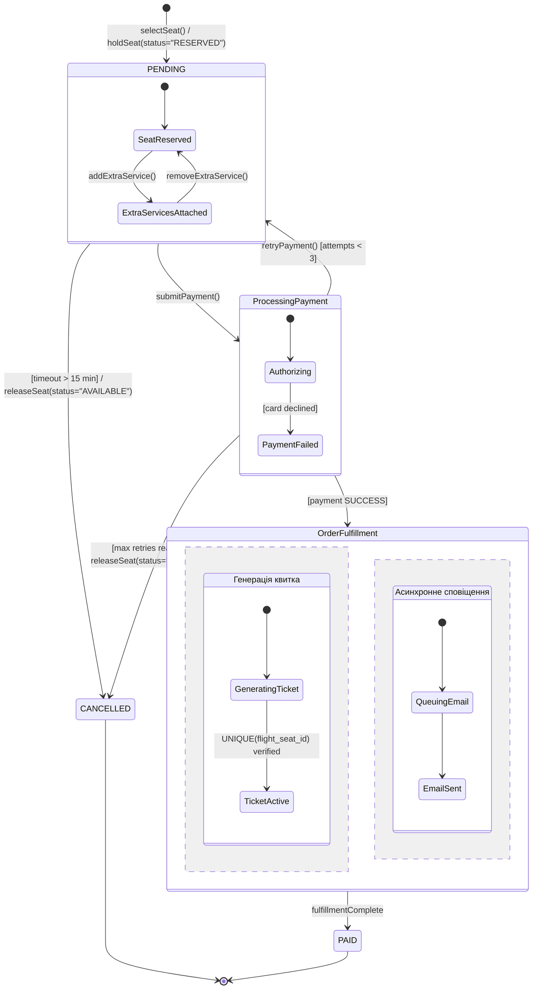

# Система бронювання авіаквитків - Машина станів

## 1. Опис станів та переходів

### Основні стани:
* **`PENDING`**: замовлення створене, місце зарезервоване на 15 хвилин (`expires_at`).
* **`ProcessingPayment`**: транзакцію відправлено на обробку в `PaymentGateway`.
* **`OrderFulfillment`**: паралельний стан виконання замовлення після успішного списання коштів.
* **`PAID`**: фінальний успішний стан (квиток згенеровано та сповіщення відправлено).
* **`CANCELLED`**: фінальний стан скасування (таймаут або відхилення платежу).

## 2. Діаграма станів (State Diagram)

