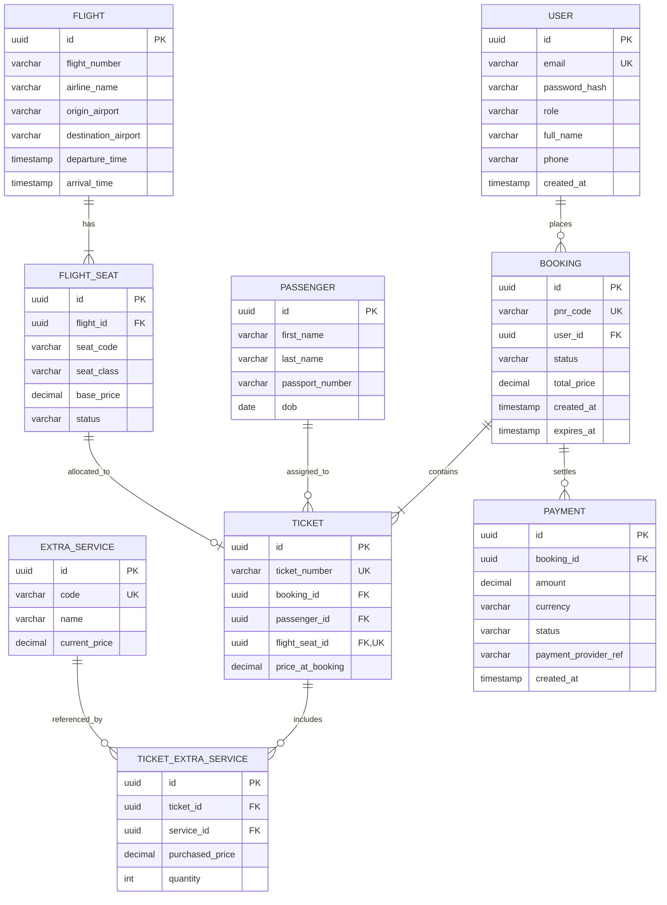
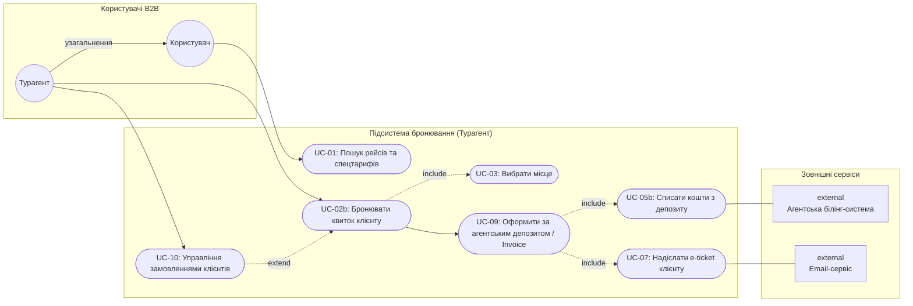
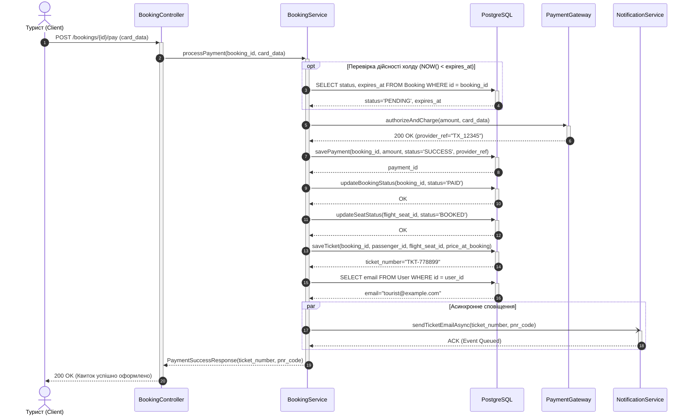
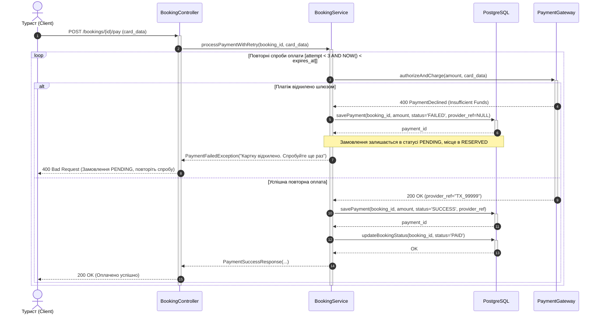
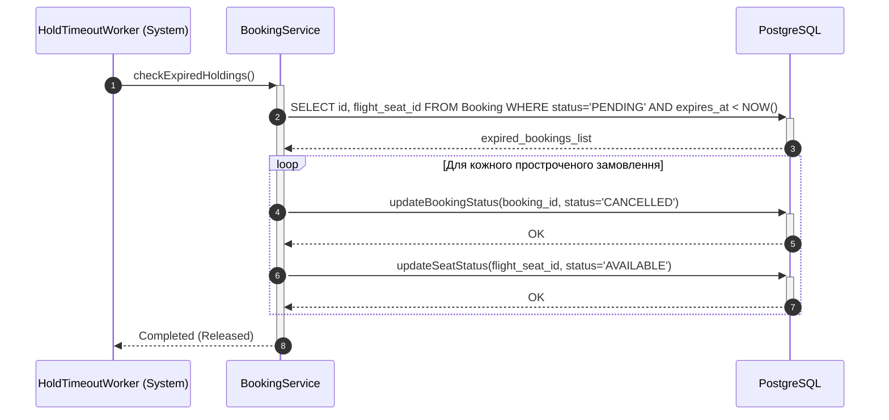

## Цей файл містить вміст readme.md з усіх попередніх робіт. Текст для ЛР №3 починається з рядка *211*

---
# ЛР №1. Система бронювання авіаквитків - домен і модель даних (ER)

Даний репозиторій містить опис даних обраного домену як моделі сутностей і зв'язків. 

## 1. Опис предметної області
Система автоматизує взаємодію між туристами, агентами та авіакомпаніями (пошук рейсів, вибір додаткових послуг, бронювання, можливість зворотного зв'язку та оплата.).

## 2. Логічна ER-модель (v4, нормалізація до 3НФ)

---

### 2. `README.md` (Огляд та Use Case діаграма)

# ЛР №2. Система бронювання авіаквитків - Вимоги та Use Cases

Цей репозиторій містить вимоги, специфіковані за синтаксисом EARS, User Stories із Gherkin-сценаріями, матрицю трасування та Use Case діаграму в межах виконання Завдання 2.

---

## 1. Діаграми прецедентів (Use Case Diagrams)

Було розроблено дві окремі діаграми (для Tourist та Agent).
### 1.1. Прецеденти Туриста (Tourist)
Демонструє персональне бронювання квитків, вибір місць, замовлення послуг та оплату банківською карткою.

### 1.2. Прецеденти Турагента (Agent)

Демонструє агентське бронювання від імені клієнта, доступ до спецтарифів, проведення розрахунків через агентський баланс та управління замовленнями клієнтів.

---

## ЛР №3. Діаграми послідовності (Sequence Diagrams) 

### 1. Сценарій 1: Успішна оплата замовлення (US-04 сценарій 1)

### 2. Сценарій 2: Відмова платіжного gateway та повтор оплати (US-04 сценарій 2)

### 3. Сценарій 3: Автоматичне скасування замовлення за таймаутом (US-05)
