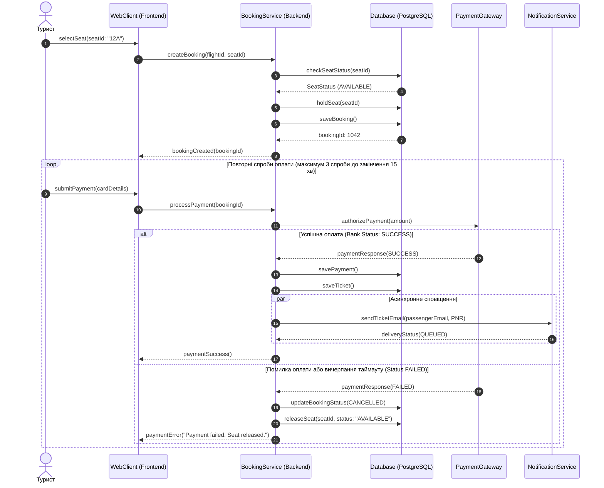

# Система бронювання авіаквитків - Взаємодія (Sequence Diagram)

---

## 1. Опис обраного сценарію та учасників

Для побудови діаграми послідовності (Sequence Diagram) обрано сукупність прецедентів **UC-02 (Бронювати квиток)** та **UC-04 (Оплатити замовлення)** із Завдання 2. Сценарій охоплює повний транзакційний цикл від вибору місця в салоні літака до отримання електронного квитка на email.

### Учасники взаємодії (Participants):
* **`Tourist`** (`actor`) - кінцевий користувач системи (пасажир).
* **`UI`** (`WebClient`) - інтерфейс користувача.
* **`API`** (`BookingService`) - бекенд бізнес-логіки системи.
* **`DB`** (`Database`) - реляційна база даних PostgreSQL (сутності `FlightSeat`, `Booking`, `Payment`, `Ticket`, `TicketExtraService`).
* **`Bank`** (`PaymentGateway`) - зовнішній платіжний шлюз для авторизації картки та списання коштів.
* **`Email`** (`NotificationService`) - зовнішній сервіс доставки електронних квитків та маршрутних квитанцій.

---

