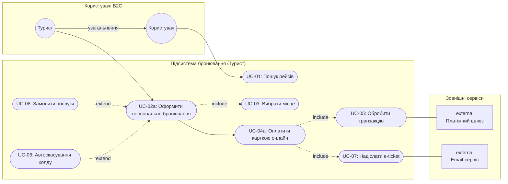

### 2. `README.md` (Огляд та Use Case діаграма)

# Система бронювання авіаквитків - Вимоги та Use Cases

Цей репозиторій містить вимоги, специфіковані за синтаксисом EARS, User Stories із Gherkin-сценаріями, матрицю трасування та Use Case діаграму в межах виконання Завдання 2.

---

## 1. Діаграми прецедентів (Use Case Diagrams)

Було розроблено дві окремі діаграми (для Tourist та Agent).
### 1.1. Прецеденти Туриста (Tourist)
Демонструє персональне бронювання квитків, вибір місць, замовлення послуг та оплату банківською карткою.

### 1.2. Прецеденти Турагента (Agent)

Демонструє агентське бронювання від імені клієнта, доступ до спецтарифів, проведення розрахунків через агентський баланс та управління замовленнями клієнтів.

